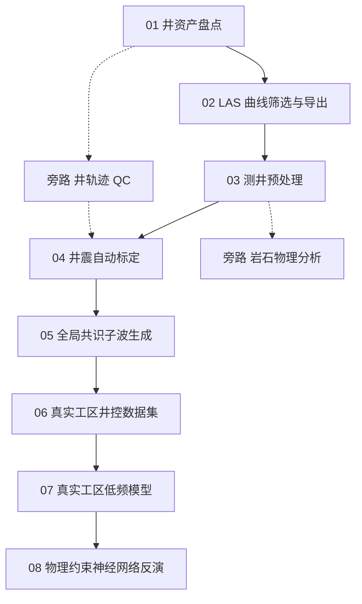

# 深度域工作流

深度域工作流使用与时间域相同的步骤入口。地震体的 `domain` 决定各步骤的采样轴；深度域额外提供深度基准，并在井震标定阶段用本井纵波速度建立局部时深关系。

前三步准备井资产、曲线筛选和测井预处理。第四步和第五步完成井震标定与共识子波生成，第六步整理井控数据，第七步建立低频模型，第八步执行物理约束神经网络反演。深度域专属的坐标转换、单位和正演输入在本页说明，其余配置见各步骤主指南。

---

## 总览



深度域运行时，公共配置至少包含：

```yaml
seismic:
  file: <seismic-volume-file>
  type: <seismic-file-type>
  domain: depth
  depth_basis: tvdss

well_usage:
  trusted_well_names:
    - <trusted-well-a>
    - <trusted-well-b>
  background_only_well_names:
    - <background-well-a>
```

可信井参与第四步、第五步以及第八步井监督。背景井跳过第四步和第五步，由第六步直接读取第三步曲线，并参与第七步低频背景建模。两类井都要通过第三步的曲线质量检查；两份名单不能重叠。

深度域的纵向采样单位是米，具体基准由 `depth_basis` 指定。井震标定内部使用以秒表示的双程旅行时；学习卷积核的时间轴也按秒定义。地震体的深度采样间隔、井曲线采样间隔和学习卷积核采样间隔分别由各自产物记录，不能互相替代。短缺口阈值仍以双程旅行时的秒数表达，由第四步记录并供后续步骤沿用。

---

## 第 4 步：井震自动标定

### 快速开始

```powershell
python scripts/well_auto_tie.py --config <config-yaml>
python scripts/well_auto_tie.py --config <config-yaml> --well <well-name>
python scripts/well_auto_tie.py --config <config-yaml> --output-dir <tie-output-dir>
```

第四步入口从 `seismic.domain` 读取当前采样域，并根据 `well_usage` 选择参与标定的井。

### 配置参考

第四步公共配置见[井震自动标定](4-well-auto-tie.md)。深度域只需将地震声明为深度域，并保证前三步来源、井轨迹、井分层和地震体属于同一工区：

```yaml
well_auto_tie:
  source_runs:
    well_inventory_dir: <well-inventory-run-dir>
    well_preprocess_dir: <well-preprocess-run-dir>
    well_trajectory_dir: <well-trajectory-run-dir>
  target_interval:
    top_horizon: <top-horizon-file>
    bottom_horizon: <bottom-horizon-file>
    margin_top_m: <top-margin-m>
    margin_bottom_m: <bottom-margin-m>
```

深度域的 `target_interval` 仍以层位对应的双程旅行时定义标定窗口。脚本先在井位读取层位深度，再通过本井局部时深关系转换到标定时间轴。

如果不使用层位文件，也可以用 `top_depth_m` 和 `bottom_depth_m` 直接给出深度边界；上下冗余使用 `margin_top_m` 和 `margin_bottom_m`，单位为米。

### 脚本在做什么

1. **确定井的用途和路由。** 读取井资产、曲线质量、井型与工区位置。背景井和名单外井记录为跳过状态，可信井继续选择直井或斜井的处理路线。
2. **建立本井局部时深关系。** 将测井深度转换到地震的深度基准；从纵波速度积分得到深度到双程旅行时的映射，并保存观测深度、速度和相对时间的对应关系。
3. **建立统一标定输入。** 在井旁或沿轨迹读取深度域地震道，把地震道和井曲线按局部时深关系插值到规则时间轴。反射系数、地震道和搜索参数在这一时间轴上保持一致。
4. **执行细标定。** 联合搜索测井去尖峰、平滑、子波尺度和整体时移，以相关系数和归一化误差评价每组结果。
5. **回写深度结果。** 将优化后的时深关系和滤波曲线映射回观测深度，保存深度域曲线、局部时深表、原始深度映射和原生深度地震道；滤波曲线中的短缺口已经修复，长缺口仍保持无效，并由 `AI_OBSERVED` 区分原始观测与修复值；合成记录与图件仍使用局部时间轴。

### 核心输出

第四步输出目录和通用文件见主指南。深度域还应检查：

| 产物 | 用途 |
|---|---|
| `wavelet_inventory.csv` | 记录每口成功可信井的候选子波及来源指标 |
| `time_depth/` | 保存标定前后的局部时深关系 |
| `depth_mapping/source_depth_mapping_<well>.csv` | 保存原始深度到双程旅行时的固定观测映射 |
| `depth_mapping/aligned_depth_<well>.csv` | 保存优化时深关系回写后的深度位置 |
| `seismic_trace/depth_seismic_trace_<well>.csv` | 保存原始深度地震道 |
| `filtered_las/` | 保存回写到观测深度的标定滤波曲线；短缺口已修复，长缺口保持无效，并保留原始观测掩码 |
| `synthetic_qc/`、`figures/` | 保存局部时间轴上的合成记录、匹配和子波图 |
| `run_summary.json` | 记录采样域、井角色、来源和每井产物路径 |

深度映射只覆盖固定初始时深关系 `T0` 支持内的连续有效 MD/TVDSS 段；支持范围外保持无效，不做端点外推。

第四步检查时，先确认局部时深关系单调且覆盖目标层段，再结合 `aligned_depth`、`source_depth_mapping` 和原生深度地震道检查回写位置。原生深度网格上的候选评分和批量波形 QC 由第五步完成。

---

## 第 5 步：全局共识子波生成

### 快速开始

```powershell
python scripts/wavelet_generation.py --config <config-yaml>
python scripts/wavelet_generation.py --config <config-yaml> --well <well-name>
python scripts/wavelet_generation.py --config <config-yaml> --output-dir <wavelet-output-dir>
```

第五步从第四步成功可信井读取候选子波，在规则时间轴上卷积正演，再通过固定的观测时深关系将合成记录采样回原始深度地震网格。在这个深度网格上交叉评测候选并搜索共识子波；子波本身保持时间采样轴。

### 配置参考

```yaml
wavelet_generation:
  source_runs:
    well_auto_tie_dir: <well-auto-tie-run-dir>
  candidate_filter:
    min_source_tie_corr: <minimum-correlation>
    exclude_source_wells: []
    include_source_wells: null
  evaluation_wells:
    exclude_wells: []
    include_wells: null
```

顶层 `well_usage` 先决定井是否有资格进入第五步；候选过滤和评测过滤只在可信井集合内部生效。背景井不提供候选子波，也不参加共识评分。

### 脚本在做什么

1. **加载候选。** 读取第四步路由、标定指标、候选子波和每井域转换产物，检查子波中心、长度、采样间隔与能量；直接使用第四步已经修复短缺口的滤波曲线。
2. **准备正演轴。** 将第四步滤波曲线依据优化时深关系转换到规则时间轴，计算反射系数，并固定每口井的原始观测深度到时间映射。
3. **交叉评测候选。** 用每条候选子波生成所有评测井的合成记录，将合成记录和观测地震共同采样回原始深度网格；评价使用第四步确定的连续窗口，窗口外的长缺口不进入评价，窗口内若仍有长缺口则该井输入无效，再在该网格上计算相关系数和归一化误差，并按空间簇聚合井间指标。
4. **搜索共识子波。** 在候选子波的主要形态空间中进行受约束搜索，综合整体匹配、差井表现、振幅误差和波形形态选择全局结果。
5. **写出批量结果。** 保存选定子波、逐井合成记录和汇总指标。深度域根据第四步的固定观测深度映射把批量 QC 回到原始深度地震网格；井控曲线继续使用第四步的回写产物。

### 核心输出

| 产物 | 用途 |
|---|---|
| `selected_wavelet.csv` | 第六步正演质检和后续步骤读取的共识子波 |
| `selected_wavelet_summary.json` | 记录共识选择、候选评测、采样定义和来源运行 |
| `batch_synthetic_metrics.csv` | 每口评测井的合成记录指标 |
| `synthetic_qc/`、`figures/` | 逐井波形、残差和子波质量控制 |
| `run_summary.json` | 记录采样域、井角色、评测井和产物路径 |

深度域正演输入使用第五步的 `selected_wavelet.csv`。正演输入旁路见本页末尾。

---

## 第 6 步：真实工区井控数据集

第六步的入口和主体配置见[真实工区井控数据集](6-real-field-well-controls.md)。深度域配置集中使用三类来源：

```yaml
real_field_well_controls:
  source_runs:
    well_auto_tie_dir: <well-auto-tie-run-dir>   # 留空自动发现
    well_preprocess_dir: <well-preprocess-run-dir> # 留空时从第四步摘要解析
    well_inventory_dir: <well-inventory-run-dir>  # 留空时从第四步摘要解析
  qc:
    forward_model_inputs_run_dir: <forward-input-run-dir> # 留空自动发现
    body_smoothing_fwhm_m: <smoothing-fwhm-m>
    dynamic_correlation_window_m: <correlation-window-m>
```

`forward_model_inputs_run_dir` 留空时自动发现与当前深度域匹配的正演输入；主体平滑和动态相关窗口均按米填写。

可信井从第四步读取已标定和回写后的曲线，第五步选定的共识子波和旁路正演输入用于正演质检；背景井从第三步读取曲线。两类井都可以写入井控清单并进入第七步，只有可信井进入第八步井监督。

### 脚本在做什么

1. **读取角色化井控来源。** 检查采样域、来源运行和井资产清单，分别加载可信井与背景井；背景井使用第三步曲线，并沿用第四步记录的秒制短缺口阈值。
2. **对齐深度轴。** 将曲线和井位转换到当前地震的深度基准，在连续有效段内插值到地震深度样点；短缺口按深度与速度折算的双程旅行时修复，长缺口保持无效。
3. **保存观测支撑。** 在原生深度轴和地震深度网格分别记录有效性掩码与原始观测掩码；缺口两侧不跨段插值。
4. **执行正演质检。** 使用第五步选定子波和深度域正演关系比较井曲线正演结果；内部长缺口两侧按子波时间范围排除受截断影响的样点，并输出固定评价支撑和实际波形样点数。

---

## 第 7 步：真实工区低频模型

第七步的通用配置见[真实工区低频模型](7-real-field-lfm.md)。深度域配置要点如下：

```yaml
real_field_lfm:
  source_runs:
    well_control_run_dir: <well-control-run-dir> # 留空自动发现
  baselines:
    depth_trend:
      method: trend
      filter:
        enabled: true
        cutoff_wavelength_m: <cutoff-wavelength-m>
        buffer_axis_units: <depth-buffer-m>
```

截止波长、缓冲长度和输出样点均按米解释。可信井和背景井都作为低频控制，空间插值使用真实平面米制坐标；井角色不会改变第七步的低频拟合资格。

### 脚本在做什么

1. **建立共同网格。** 读取深度域地震、层位和井控，确定输出体的平面与深度轴。
2. **提取井内低频信息。** 在每口井的连续有效段内按深度距离执行低通，显式缓冲后检查滤波器长度，保持长缺口边界独立，不跨段运算。
3. **拟合空间基线。** 按相对层位位置拟合纵向趋势或比例切片，并在真实平面坐标上插值。
4. **写出变体。** 保存低频模型、有效性信息、拟合质检和变体比较。

---

## 第 8 步：物理约束神经网络反演

第八步的通用配置见[物理约束神经网络反演](8-ginn.md)。深度域训练配置至少包含：

```yaml
ginn_v3_body_inversion:
  inputs:
    lfm_run_dir: <lfm-run-dir> # 留空自动发现
    variant_id: <lfm-variant-id>
    well_control_run_dir: <well-control-run-dir> # 留空自动发现
    ai_velocity_relation:
      formula: "AI = a * Vp + b"
      a: <ai-vp-coefficient-a>
      b: <ai-vp-intercept-b>
      ai_unit: m/s*g/cm3
      vp_unit: m/s
      a_unit: g/cm3
      b_unit: m/s*g/cm3
  kernel:
    dt_s: <kernel-sampling-interval-s>
    duration_s: <kernel-duration-s>
```

深度域输入必须在 `velocity_volume` 和 `ai_velocity_relation` 之间选择一个。上例使用单位明确的 AI–Vp 关系；如果使用速度体，则将其路径填入 `inputs.velocity_volume`，并删除 `ai_velocity_relation`。

全局可信井名单来自顶层 `well_usage`。如需只使用其中一部分训练，可在第八步段落中提供训练子集；背景井始终只提供第七步低频背景，不参与第八步井监督。

### 脚本在做什么

1. **准备深度域样本。** 读取地震、井控和低频模型，在共同深度轴上建立训练与验证道；有效掩码和原始观测掩码分别保留，短缺口修复值可进入井目标，长缺口保持无效。
2. **建立正演关系。** 由速度体或 AI–Vp 关系得到正演速度，把相邻阻抗样点中点的界面位置转换为双程旅行时；内部长缺口两侧按学习核时间范围排除不完整响应样点，计算窗两端沿用现有边界约定。
3. **预测阻抗与学习核。** 网络输出阻抗修正和以秒为单位的学习卷积核，修正直接叠加到低频模型。
4. **联合更新。** 使用可信井监督、预测正演和批间卷积核交换三项约束更新网络。
5. **评价和输出。** 保存检查点、学习卷积核、井旁 QC；体预测由独立入口按需执行。

---

## 深度域正演输入旁路

当第六步需要使用固定 AI–Vp 关系和共识子波进行井控质检时，运行正演输入旁路：

```powershell
python scripts/depth_forward_model_inputs.py --config <config-yaml>
python scripts/depth_forward_model_inputs.py --config <config-yaml> --output-dir <forward-input-output-dir>
```

配置使用第五步的选定子波：

```yaml
depth_forward_model_inputs:
  source_runs:
    rock_physics_analysis_dir: <rock-physics-run-dir>
    wavelet_generation_dir: <wavelet-generation-run-dir>
```

### 脚本在做什么

1. 读取岩石物理分析产出的 AI–Vp 关系和第五步选定子波。
2. 检查子波采样、零时刻和能量归一化，以及关系式和单位。
3. 汇总来源运行、关系系数和选定子波路径，写出固定正演输入。

这条旁路只组装正演输入，不改变第四步和第五步的井震标定结果。

---

## 深度域结果检查顺序

1. 先检查第四步每口可信井的局部时深关系是否单调、覆盖目标层段，并查看局部时间轴 QC 与深度映射产物。
2. 再检查第五步候选子波、共识选择和逐井批量合成结果，确认共识子波没有由单口井主导。
3. 检查第六步的可信井、背景井角色和有效性掩码，确认背景井只进入低频建模。
4. 最后查看第七步低频模型与第八步井旁监督结果，确保所有深度轴和空间几何来自同一地震体。
