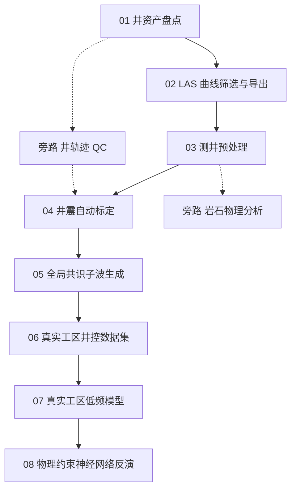

# 工作流总览

## 配置文件

| 步骤 | 配置文件 |
|------|---------|
| 01–07 | `experiments/common/common.yaml` |
| 07 · modifier 实验 | `experiments/real_field_lfm/real_field_lfm.yaml` |
| 旁路 · well_trajectory | `experiments/common/common.yaml` |
| 旁路 · rock_physics_analysis | `experiments/common/common.yaml` |
| 旁路 · synthoseis_lite | `experiments/synthoseis_lite/synthoseis_lite.yaml` |
| 08 · 物理约束神经网络反演 | `<inversion-config-yaml>` |

## 深度域工作流

深度域工作流复用全部步骤的统一入口。步骤根据 `seismic.domain` 读取时间轴或深度轴，并在需要时使用本井速度建立局部时深关系。深度轴、局部时深转换和深度域正演输入的细节见
[深度域工作流](guide/depth-domain-workflow.md)。
